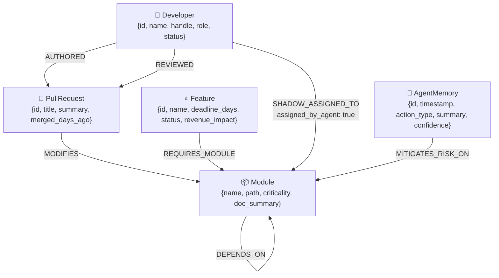

# BusFactor Zero                                             
LIVE DEMO : https://busfactor-zero.onrender.com

## Autonomous Company Brain & Engineering Bottleneck GraphRAG Agent

> **WeMakeDevs × FalkorDB Hackathon Submission** · October 2026  
> **Tracks:** Company Brain · Agents That Act on Connected Data · Agent Memory and Coordination

---

## What is BusFactor Zero?

Every engineering organisation has a hidden **bus factor problem**: a handful of developers who are the *sole* experts for critical modules. If they go on leave, get sick, or switch jobs — entire product lines stall.

**BusFactor Zero** is an autonomous AI agent that:

1. **Continuously audits** your engineering graph in FalkorDB to detect single-point-of-failure modules  
2. **Simulates** the organisational blast radius when any developer becomes unavailable  
3. **Recommends backup engineers** using graph-collaborative-filtering on the FalkorDB knowledge graph  
4. **Generates technical handoff packets** by retrieving PR summaries from the graph (GraphRAG) and synthesising them with an LLM  
5. **Commits its decisions back into FalkorDB** as `AgentMemory` nodes and `SHADOW_ASSIGNED_TO` edges — encoding coordination state permanently in the graph

---

## Tracks Entered

| Track | How This Project Qualifies |
|-------|--------------------------|
| **Company Brain** | FalkorDB stores the full engineering org: developers, modules, PRs, features, agent memory. The agent surfaces hidden risk patterns invisible in flat databases. |
| **Agents That Act on Connected Data** | The agent executes multi-hop Cypher traversals (up to 3 hops on `DEPENDS_ON` edges) to calculate blast radius, then *mutates* the graph with handoff decisions. |
| **Agent Memory and Coordination** | Every mitigation action creates a persistent `AgentMemory` node in FalkorDB and a `SHADOW_ASSIGNED_TO` edge — the graph *is* the agent's memory. |

---

## Why FalkorDB is Essential (Not Optional)

Removing FalkorDB would break the core value of this project:

- **Multi-hop blast radius** (`DEPENDS_ON*1..3`) requires graph traversal — impossible in SQL without recursive CTEs across multiple tables  
- **Graph collaborative filtering** for backup engineers traverses REVIEWED → PullRequest → MODIFIES → Module → DEPENDS_ON → adjacent authors in a single Cypher query  
- **AgentMemory as graph state** — the agent's decisions become first-class graph nodes, enabling future agents to read prior coordination history via Cypher  
- **Degree aggregation** (`collect(DISTINCT d.handle)`, `size(experts) = 1`) across the PR authorship graph detects bus-factor = 1 in one query

---

## Graph Data Model



### Node Properties

| Node | Properties |
|------|-----------|
| `Developer` | `id`, `name`, `handle`, `role`, `status` |
| `Module` | `name`, `path`, `criticality`, `doc_summary` |
| `PullRequest` | `id`, `title`, `summary`, `merged_days_ago` |
| `Feature` | `id`, `name`, `deadline_days`, `status`, `revenue_impact` |
| `AgentMemory` | `id`, `timestamp`, `action_type`, `summary`, `confidence` |

### Relationship Types

| Relationship | From → To | Description |
|---|---|---|
| `AUTHORED` | Developer → PullRequest | Developer wrote this PR |
| `REVIEWED` | Developer → PullRequest | Developer code-reviewed this PR |
| `MODIFIES` | PullRequest → Module | PR changed this module |
| `DEPENDS_ON` | Module → Module | Module has a runtime/build dependency |
| `REQUIRES_MODULE` | Feature → Module | Feature needs this module to ship |
| `SHADOW_ASSIGNED_TO` | Developer → Module | Agent assigned developer as backup owner |
| `MITIGATES_RISK_ON` | AgentMemory → Module | Agent memory record addresses this module's risk |

---

## The 4 Core Cypher Queries

### Q1 — Detect Bus Factor Bottlenecks

Finds active Features whose required Modules have exactly **one** PR author **and zero agent-assigned shadow maintainers** (bus factor = 1). Shadow assignments from Q4 immediately resolve bottlenecks once committed.

```cypher
MATCH (f:Feature {status: 'in_progress'})-[:REQUIRES_MODULE]->(m:Module)
MATCH (d:Developer)-[:AUTHORED]->(pr:PullRequest)-[:MODIFIES]->(m)
OPTIONAL MATCH (shadow:Developer)-[:SHADOW_ASSIGNED_TO]->(m)
WITH m,
     collect(DISTINCT d.handle) AS authors,
     collect(DISTINCT shadow.handle) AS shadows,
     collect(DISTINCT f.name) AS blocking_features,
     min(f.deadline_days) AS min_deadline_days,
     collect(DISTINCT f.revenue_impact) AS revenue_impacts
WHERE size(authors) = 1 AND size(shadows) = 0
RETURN m.name AS module,
       m.criticality AS criticality,
       m.doc_summary AS doc_summary,
       authors[0] AS sole_expert,
       blocking_features[0] AS blocking_feature,
       blocking_features AS all_blocking_features,
       min_deadline_days AS deadline_days,
       revenue_impacts[0] AS revenue_impact,
       size(authors) AS bus_factor
ORDER BY
  CASE m.criticality
    WHEN 'critical' THEN 0
    WHEN 'high' THEN 1
    WHEN 'medium' THEN 2
    ELSE 3
  END ASC,
  min_deadline_days ASC
```

**Why this needs FalkorDB:** Requires traversing Developer → PullRequest → Module → Feature in a single query, then aggregating unique authors per module. The `size(experts) = 1` filter on a graph-aggregated collection is native to property graph databases.

---

### Q2 — Simulate Developer Unavailable (Blast Radius)

Multi-hop graph traversal calculating the organisational impact of a developer becoming unavailable. Traverses up to 3 hops on `DEPENDS_ON` edges to find cascading module risk.

Traverses **both** downstream consumers (`<-[:DEPENDS_ON*1..3]-`) AND upstream integrations (`-[:DEPENDS_ON*1..2]->`) to capture the full organisational blast radius.

```cypher
MATCH (d:Developer {handle: $dev_handle})
MATCH (d)-[:AUTHORED]->(pr:PullRequest)-[:MODIFIES]->(direct_module:Module)
WITH d, collect(DISTINCT direct_module) AS direct_modules
UNWIND direct_modules AS dm
OPTIONAL MATCH (dependent:Module)-[:DEPENDS_ON*1..3]->(dm)
WHERE NOT (dependent IN direct_modules)
WITH d, direct_modules, collect(DISTINCT dependent) AS cascade_dependents
UNWIND direct_modules AS dm2
OPTIONAL MATCH (dm2)-[:DEPENDS_ON*1..2]->(upstream:Module)
WHERE NOT (upstream IN direct_modules) AND NOT (upstream IN cascade_dependents)
WITH d, direct_modules, cascade_dependents, collect(DISTINCT upstream) AS upstream_deps
WITH d, direct_modules, (cascade_dependents + upstream_deps) AS all_cascade
UNWIND (direct_modules + all_cascade) AS impacted_mod
OPTIONAL MATCH (f:Feature)-[:REQUIRES_MODULE]->(impacted_mod)
WITH d, direct_modules, all_cascade, collect(DISTINCT f) AS blocked_features
RETURN d.name AS developer,
       d.handle AS handle,
       [m IN direct_modules WHERE m IS NOT NULL | m.name] AS directly_compromised,
       [m IN all_cascade WHERE m IS NOT NULL | m.name] AS cascade_compromised,
       [feat IN blocked_features WHERE feat IS NOT NULL | {
           name: feat.name,
           revenue: feat.revenue_impact,
           deadline: feat.deadline_days,
           status: feat.status
       }] AS blocked_features,
       size(direct_modules) + size(all_cascade) AS blast_radius_score
```

**Why this needs FalkorDB:** Variable-length path traversal (`DEPENDS_ON*1..3`) is native to graph databases. Equivalent SQL requires 3 self-joins or a recursive CTE that breaks down with complex schemas.

---

### Q3 — Recommend Backup Engineer (Graph Collaborative Filtering)

Finds the best backup engineers by graph proximity — reviewers of PRs on the module score highest; authors of adjacent modules (via `DEPENDS_ON`) score next.

Uses pure OpenCypher **scalar projections** to avoid null-map grouping issues. Weights: co-authored PRs on module (+4 pts), reviewed PRs on module (+3 pts), authored PRs on 1–2 hop DEPENDS_ON neighbours (+1 pt).

```cypher
MATCH (m:Module {name: $module_name})
MATCH (cand:Developer {status: 'active'})
WHERE cand.handle <> $unavailable_dev
OPTIONAL MATCH (cand)-[:REVIEWED]->(rpr:PullRequest)-[:MODIFIES]->(m)
WITH m, cand, count(DISTINCT rpr) AS review_count
OPTIONAL MATCH (m)-[:DEPENDS_ON*1..2]-(adj:Module)<-[:MODIFIES]-(apr:PullRequest)<-[:AUTHORED]-(cand)
WHERE adj.name <> m.name
WITH m, cand, review_count, count(DISTINCT apr) AS adjacent_pr_count, collect(DISTINCT adj.name) AS adj_modules
OPTIONAL MATCH (cand)-[:AUTHORED]->(cpr:PullRequest)-[:MODIFIES]->(m)
WITH cand, review_count, adjacent_pr_count, adj_modules, count(DISTINCT cpr) AS coauthor_count
WITH cand,
     (coauthor_count * 4) + (review_count * 3) + (adjacent_pr_count * 1) AS proximity_score,
     (CASE WHEN coauthor_count > 0 THEN ['Co-authored PRs on this module'] ELSE [] END) +
     (CASE WHEN review_count > 0 THEN ['Reviewed ' + toString(review_count) + ' PR(s) on this module'] ELSE [] END) +
     (CASE WHEN adjacent_pr_count > 0 THEN ['Maintains adjacent modules: ' + coalesce(adj_modules[0], '')] ELSE [] END) AS reasons
WHERE proximity_score > 0
RETURN cand.name AS recommended_dev,
       cand.handle AS handle,
       cand.role AS role,
       proximity_score,
       reasons
ORDER BY proximity_score DESC, cand.name ASC
LIMIT 3
```

**Why this needs FalkorDB:** Collaborative filtering on graph proximity (traversing REVIEWED edges AND DEPENDS_ON adjacency simultaneously) requires multi-relationship path traversal that would require multiple JOINs and UNION queries in SQL.

---

### Q4 — Commit Agent Handoff Memory (Live Graph Mutation)

Writes the agent's coordination decision permanently into FalkorDB: creates an `AgentMemory` node with the GraphRAG-generated handoff briefing, then creates `SHADOW_ASSIGNED_TO` and `MITIGATES_RISK_ON` edges.

Pre-MATCHes both `Module` and `Developer` before `CREATE` to prevent dangling nodes if either lookup fails.

```cypher
MATCH (m:Module {name: $module_name})
MATCH (d:Developer {handle: $backup_dev_handle})
CREATE (mem:AgentMemory {
    id: $memory_id,
    timestamp: $timestamp,
    action_type: 'handoff_briefing',
    module_name: $module_name,
    backup_handle: $backup_dev_handle,
    summary: $handoff_summary,
    confidence: $confidence
})
CREATE (mem)-[:MITIGATES_RISK_ON]->(m)
MERGE (d)-[r:SHADOW_ASSIGNED_TO {assigned_by_agent: true}]->(m)
SET r.timestamp = $timestamp, r.memory_id = $memory_id
RETURN mem.id AS memory_id,
       d.name AS backup_dev,
       d.handle AS backup_handle,
       m.name AS module,
       mem.timestamp AS committed_at
```

**Why this needs FalkorDB:** The agent's memory is encoded as a first-class graph node with typed edges. Future agents can query this memory using Cypher to find which modules have been mitigated, by whom, and with what confidence score.

---

## API Reference

| Method | Endpoint | Description |
|--------|----------|-------------|
| `GET` | `/` | Interactive dashboard SPA |
| `GET` | `/api/health` | FalkorDB connectivity + node count |
| `GET` | `/api/graph` | All nodes + edges (Vis.js format) |
| `GET` | `/api/bottlenecks` | Q1 — Bus Factor detection |
| `GET` | `/api/audit` | Company-wide risk audit + executive summary |
| `GET` | `/api/developers` | Developer list for UI selector |
| `POST` | `/api/simulate-leave` | Q2+Q3+GraphRAG full agent pipeline |
| `POST` | `/api/agent/mitigate` | Q4 — commit AgentMemory to FalkorDB |
| `POST` | `/api/seed` | Reset + re-seed the graph |
| `POST` | `/api/ingest-github` | Ingest public GitHub repo PRs |

---

## Setup & Running Locally

### Prerequisites

- Python 3.11+
- Docker (for FalkorDB)
- Git

### 1. Clone the Repository

```bash
git clone https://github.com/YOUR_USERNAME/busfactor-zero
cd busfactor-zero
```

### 2. Start FalkorDB with Docker

```bash
docker run -d --name falkordb -p 6379:6379 falkordb/falkordb:latest
```

Verify FalkorDB is running:
```bash
docker ps | grep falkordb
```

### 3. Create Virtual Environment & Install Dependencies

```bash
python -m venv venv

# Windows
venv\Scripts\activate

# macOS/Linux
source venv/bin/activate

pip install -r requirements.txt
```

### 4. Configure Environment Variables

```bash
cp .env.example .env
```

Edit `.env`:
```env
FALKORDB_HOST=localhost
FALKORDB_PORT=6379
FALKORDB_USERNAME=
FALKORDB_PASSWORD=
FALKORDB_SSL=false
FALKORDB_GRAPH=CompanyBrain

# Optional — app works without a key using the fallback synthesizer
OPENAI_API_KEY=sk-...
```

### 5. Seed the Graph

```bash
python seed_graph.py
```

Expected output:
```
🌱 Seeding FalkorDB 'CompanyBrain' graph...
  ✓ Cleared existing graph data
  ✓ Created 6 Developer nodes
  ✓ Created 8 Module nodes
  ✓ Created 9 DEPENDS_ON edges
  ✓ Created 12 PullRequest nodes with AUTHORED/REVIEWED/MODIFIES edges
  ✓ Created 4 Feature nodes with REQUIRES_MODULE edges
✅ Graph seeded successfully!
```

### 6. Start the FastAPI Server

```bash
uvicorn main:app --reload --host 0.0.0.0 --port 8000
```

Open your browser: **http://localhost:8000**

### 7. Optional: Ingest Real GitHub Data

The ingestion engine partitions PRs into logical sub-modules based on title/body keywords, creates `DEPENDS_ON` edges between them, and synthesises `Feature` nodes so that Q1–Q3 immediately produce real bus-factor results for any public repo.

```bash
# Via CLI (appends to existing graph)
python seed_graph.py --github arshsk16/cortex

# Via API — replace existing graph with this repo (clear_existing defaults to true)
curl -X POST http://localhost:8000/api/ingest-github \
  -H "Content-Type: application/json" \
  -d '{"owner": "arshsk16", "repo": "cortex", "max_prs": 20, "clear_existing": true}'

# Append to existing graph without clearing
curl -X POST http://localhost:8000/api/ingest-github \
  -H "Content-Type: application/json" \
  -d '{"owner": "FalkorDB", "repo": "falkordb-py", "max_prs": 20, "clear_existing": false}'
```

**Sub-module classification keywords:**

| Suffix | Matched keywords in PR title/body |
|--------|----------------------------------|
| `-auth` | auth, oauth, jwt, login, session, sso, token, saml, permission, rbac |
| `-api` | api, route, endpoint, handler, middleware, gateway, proxy, rest, graphql |
| `-cli` | cli, command, terminal, shell, script, argparse, click, typer |
| `-testing` | test, spec, fixture, mock, pytest, jest, coverage, ci, lint |
| `-infra` | deploy, docker, k8s, kubernetes, terraform, helm, release, build, pipeline |
| `-core` | core, engine, base, model, schema, database, orm, redis, cache *(default)* |

### Using FalkorDB Cloud (instead of Docker)

```env
FALKORDB_HOST=redis-XXXXX.c1.us-east-1-2.ec2.cloud.redislabs.com
FALKORDB_PORT=12345
FALKORDB_USERNAME=default
FALKORDB_PASSWORD=your_password_here
FALKORDB_SSL=true
FALKORDB_GRAPH=CompanyBrain
```

---

## Project Structure

```
busfactor-zero/
├── ARCHITECTURE_AND_RULES.md   # Complete technical reference
├── README.md                   # This file
├── requirements.txt            # Python dependencies
├── .env.example                # Environment variable template
├── seed_graph.py               # Graph seeding + GitHub ingestion
├── graph_queries.py            # 4 core Cypher functions
├── agent.py                    # Autonomous GraphRAG agent
├── main.py                     # FastAPI server
└── static/
    └── index.html              # Interactive dashboard SPA
```

---

## Synthetic Dataset

The seeded graph contains:

| Type | Count | Details |
|------|-------|---------|
| Developers | 6 | Priya, Marcus, Amara, Lena, Tariq, Sofia — varied roles |
| Modules | 8 | auth-service, billing-engine, data-pipeline, api-gateway, ml-inference, notification-service, user-profile, audit-log |
| DEPENDS_ON edges | 9 | Multi-hop dependency chains (e.g. api-gateway → auth-service → audit-log) |
| PullRequests | 12 | Realistic technical summaries (SAML, PKCE, Stripe, dbt, ONNX, etc.) |
| Features | 4 | SSO Enterprise Login ($2.4M ARR), Usage-Based Billing ($1.8M ARR), AI Churn Prediction, Smart Campaigns |

---

## How the GraphRAG Pipeline Works

```
1. FalkorDB Graph (source of truth)
         │
         ▼
2. Q1: detect_bus_factor_bottlenecks()
   → Cypher aggregation identifies modules with sole_expert count = 1
         │
         ▼
3. Q2: simulate_developer_unavailable(handle)
   → Multi-hop DEPENDS_ON*1..3 traversal calculates blast radius
         │
         ▼
4. Q3: recommend_backup_engineer(module, unavailable_dev)
   → Graph collaborative filtering ranks candidates by proximity score
         │
         ▼
5. GraphRAG Retrieval
   → Cypher fetches PR summaries for at-risk modules from FalkorDB
   → These become the "retrieved context" (RAG documents)
         │
         ▼
6. LLM Generation (GPT-4o or fallback synthesizer)
   → Generates structured handoff packet using PR context
         │
         ▼
7. Q4: commit_agent_handoff_memory()
   → Creates AgentMemory node + SHADOW_ASSIGNED_TO edge in FalkorDB
   → Agent's decision is now first-class graph data
         │
         ▼
8. FalkorDB (mutated — graph reflects new coordination state)
```

---

## Dashboard Features

| Feature | Description |
|---------|-------------|
| **Live Graph Visualization** | Vis.js network with colour-coded nodes (Developer=green, Module=cyan, PR=violet, Feature=amber, AgentMemory=rose) and shaped by type |
| **Bus Factor Scan** | One-click Q1 execution showing all bottleneck modules with criticality badges and revenue at risk. Clicking a card focuses the sole-expert node in the live graph. |
| **Developer Leave Simulator** | Select any developer → triggers full 5-step agent pipeline |
| **Blast Radius Panel** | Shows directly compromised modules + bidirectional cascade via DEPENDS_ON*1..3 + blocked features |
| **Backup Recommendations** | Graph-ranked backup engineers with proximity scores and selection reasons |
| **AI Handoff Packet** | LLM-generated technical onboarding document with architecture summary and checklist |
| **Cypher Inspector** | Live panel showing the exact Cypher query executed at each step — syntax highlighted |
| **One-Click Graph Mutation** | "Commit to FalkorDB" button writes AgentMemory + SHADOW_ASSIGNED_TO and refreshes the live graph |
| **Graph Reseed** | Reset and repopulate the entire graph with one button click |
| **Live GitHub Repo Ingest** | Enter any `owner/repo` (default: `arshsk16/cortex`). PRs are auto-classified into sub-modules (`{repo}-core`, `{repo}-api`, `{repo}-auth`, `{repo}-cli`, `{repo}-infra`) by title keyword matching. DEPENDS_ON edges and Feature nodes are synthesised automatically so Q1–Q3 produce real results immediately. A **"Replace synthetic graph"** checkbox (`clear_existing=true`, checked by default) wipes the existing graph first so only the ingested repo is shown. |
| **Precision Graph Zoom Toolbar** | Floating toolbar in the bottom-right corner of the graph canvas: ➕ Zoom In, ➖ Zoom Out, ⊡ Fit All Nodes, 🎯 Focus Selected Node, ⚛ Physics On/Off toggle. Physics is automatically disabled after stabilisation to stop graph drift while preserving interactive node dragging. |
| **Expand / Collapse Panels** | "⬡ Expand" button on the graph canvas hides the left sidebar (graph spans 9 of 12 columns). "⬡ Expand" on the right panel hides the center graph for a wider handoff packet view. |

---

## AI Disclosure (Rule 19)

This project was built with the assistance of **Google Antigravity (Gemini)**, an AI coding assistant.

**AI-assisted components:**
- Initial project scaffolding and file structure
- Cypher query design and optimisation
- FastAPI endpoint implementation
- Frontend dashboard layout and Vis.js integration
- Fallback synthesizer logic
- README and documentation

**Human-designed components:**
- Overall system architecture and GraphRAG pipeline design
- FalkorDB graph schema (node labels, relationship types, property names)
- Synthetic dataset (developer personas, module names, PR summaries, feature descriptions)
- Hackathon track alignment and project concept
- Business logic for blast radius scoring and proximity ranking

All AI-generated code was reviewed, tested, and validated by the project author before submission.

---

## License

MIT License — see [LICENSE](LICENSE) for details.

---

*Built for the WeMakeDevs × FalkorDB Hackathon, October 2026.*  
*"Because the bus factor is a graph problem."*
